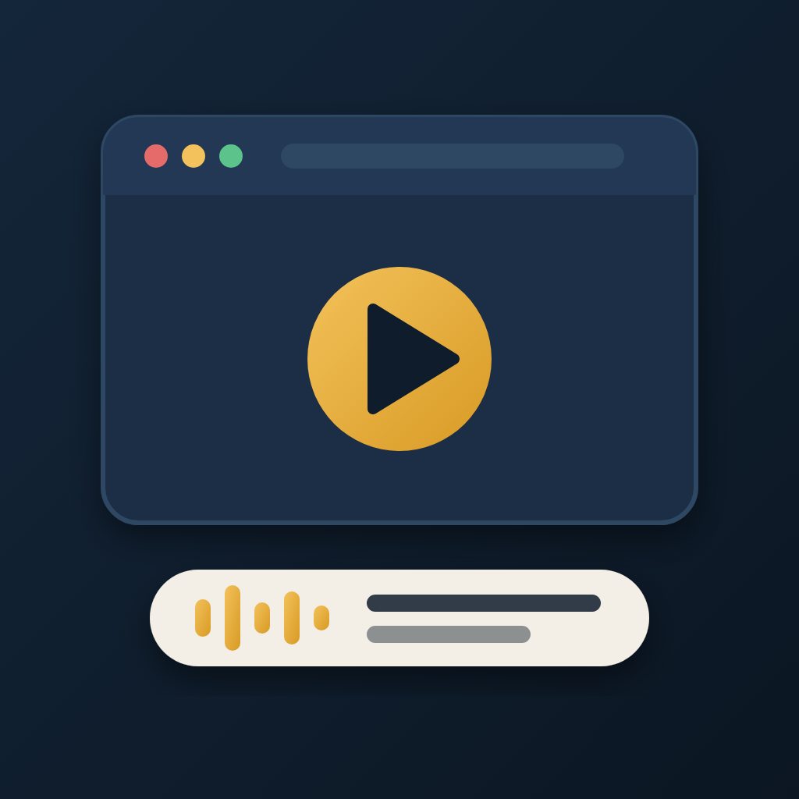

<p align="center"></p>

# claude-walkthrough-video

A Claude Code skill that makes a narrated walkthrough video of your web app, from a script.

It drives your real app with Playwright, reads a script aloud with a local voice (Kokoro), adds captions and opening slides, and writes a 1080p MP4 plus an `.srt`. Everything runs on your machine. Re-record any scene when the app changes.

```
narration -> local voice -> WAV per scene + caption timings
real app  -> Playwright scenes -> clips + markers   -> walkthrough.mp4 + .srt
```

## Install

As a plugin (recommended):

```
/plugin marketplace add Hamza-Akhtar008/claude-walkthrough-video
/plugin install walkthrough-video@claude-walkthrough-video
```

Or as a plain skill: copy `skills/walkthrough-video/` into `~/.claude/skills/` (all projects) or `.claude/skills/` (one project).

## Use it

In Claude Code, in the project you want to film:

> Make a 3-minute narrated walkthrough video of this app for new developers. Show the sign-up flow, the dashboard and the settings page.

The skill takes it from there and stops at three points for your approval: the storyboard, then the narration and voice, then the recording. It also works for "re-record scene 4" or "add an intro slide".

## What you need

Node 20+, Playwright, FFmpeg (with `xfade`, `zoompan`, `loudnorm`, `libx264`), Python 3.11 or 3.12, and about 350 MB for the voice model. See `skills/walkthrough-video/references/setup.md`.

## What is inside

- `skills/walkthrough-video/SKILL.md` the instructions Claude follows.
- `scripts/` the recorder, voice, caption and assembly scripts (copied into your project when you use the skill).
- `templates/` starting points for scenes, a saved login, slides and the narration file.
- `references/` the toolkit guide, setup, and lessons learned.

## Good to know

- It records only what the real app does. Use a demo account and cover anything private on screen.
- Browser recordings cannot capture microphone or voice-agent audio: the skill shows the interface and the narration explains.
- It never clicks buttons that send, publish or delete on real accounts; it hovers and explains.

## Privacy

This plugin has no service behind it. It sends nothing to its author or to any third party, and it has no analytics.

- **What it does on your machine:** it opens your app in a browser, records the pages, and writes the results (frames, clips, voice files, captions, the finished video) into a folder in your project. Whatever is on screen while it records ends up in those files, so use a demo account and cover anything private.
- **Saved login:** if you choose to save a sign-in session so scenes can reuse it, it is stored in a local file in your project. The scripts never read, ask for or store passwords. Keep that file out of git (the included `.gitignore` lines do).
- **What it downloads:** the Playwright browser, the Python packages, and the Kokoro voice model files (from GitHub). These are downloads only; none of your data is uploaded.
- **The voice runs locally:** no text or audio is sent to a cloud speech service.
- **Not intended for people under 18.** It is a developer tool.

## Licence

MIT (see `LICENSE`). Third-party tools are downloaded, not bundled: Playwright (Apache-2.0), Kokoro-82M (Apache-2.0), kokoro-onnx (MIT). FFmpeg is LGPL or GPL depending on your build.
